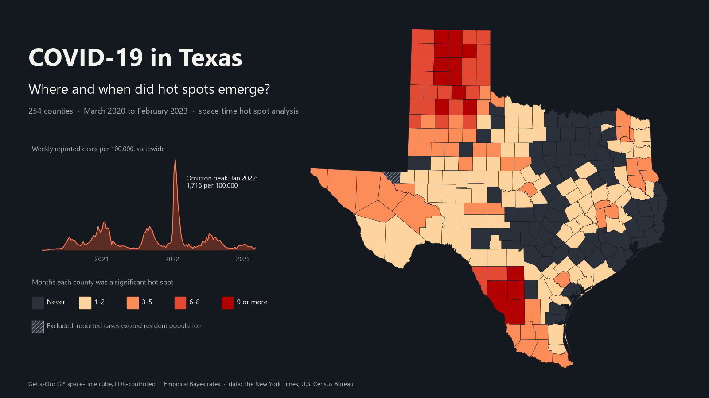
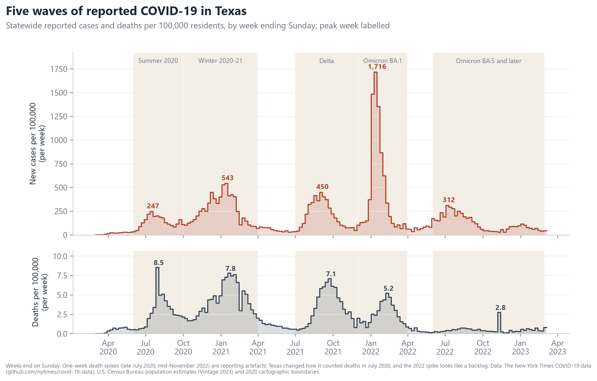
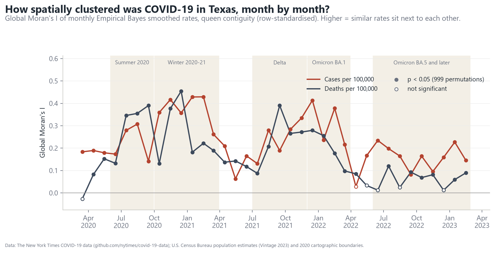
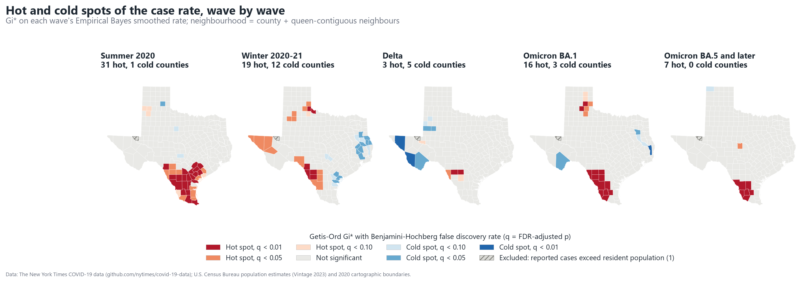
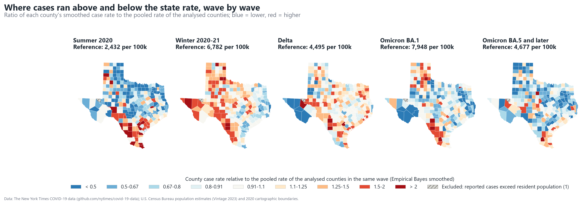
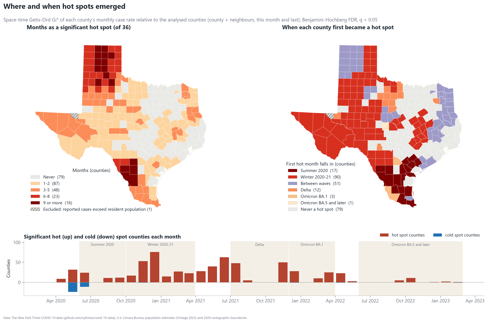
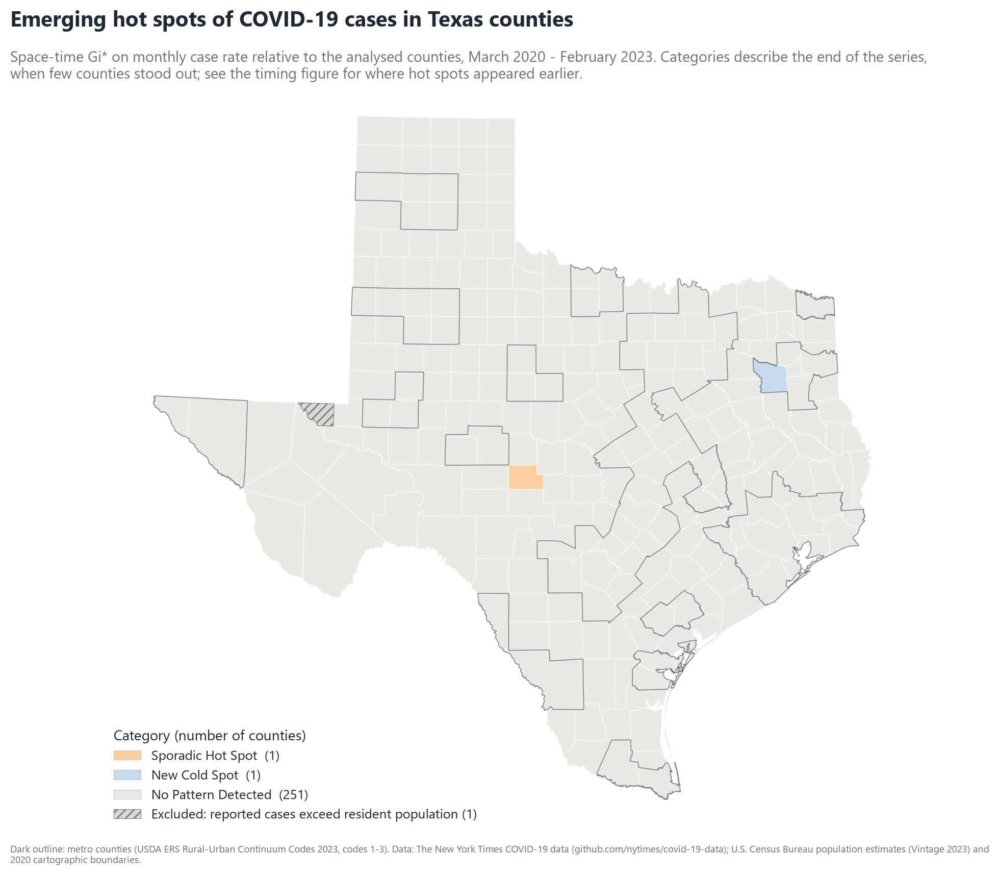
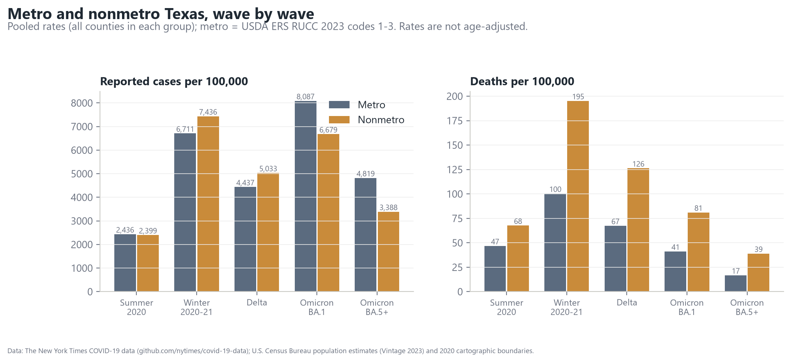
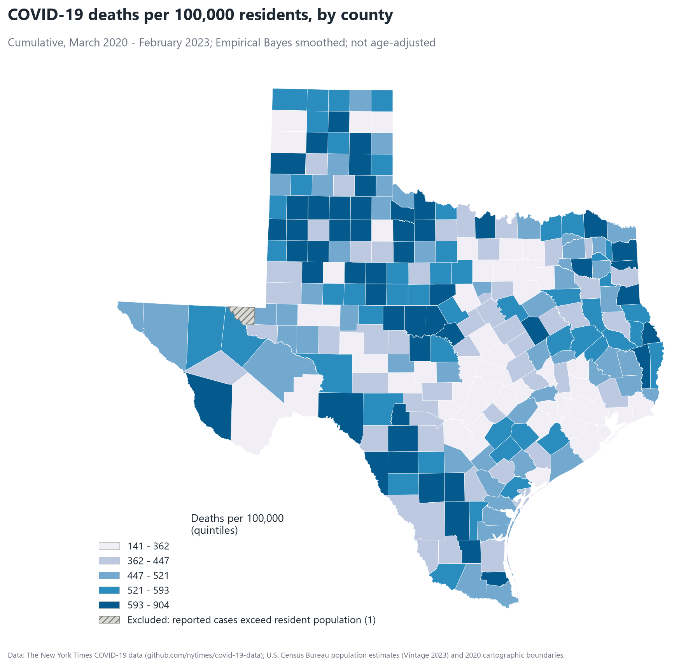

# COVID-19 in Texas counties, 2020–2023: where and when did hot spots emerge?

Texas went through five large waves of COVID-19 between 2020 and 2023, but they did not hit every county at the same time or with the same force. This project asks which counties formed statistically significant clusters of high (or low) case rates, when those clusters first appeared, and how the pattern changed from wave to wave.



**Interactive map:** https://landon2199.github.io/texas-covid-spacetime/ (GitHub Pages, served from `/docs`). Step through the 36 months, switch between hot spots, smoothed rates, Gi* by wave and death rates, and hover any county for its numbers.

Every number below counts people. Behind the 94,059 deaths in this dataset are families and communities across all 254 counties. The aim here is to describe the pattern carefully, not to rank places.

## Key findings

All numbers come from `results/metrics.json` (March 2020 – February 2023, 254 counties, 8,241,305 reported cases and 94,059 deaths). Statewide totals use all 254 counties. The county statistics (findings 2–5) use 253: Loving County is left out because it reported more cases than it has residents (see [Excluded county](#excluded-county-and-sensitivity-analysis)).

**1. Five waves, very different in size.** Statewide weekly peaks (reported cases per 100,000 residents, weeks ending Sunday):

| Wave | Window | Peak week | Cases / 100k that week | Peak deaths / 100k / week (week) |
|---|---|---|---|---|
| Summer 2020 | Jun–Sep 2020 | 2020-07-19 | 246.8 | 8.54 (2020-08-02)* |
| Winter 2020–21 | Oct 2020–Mar 2021 | 2021-01-17 | 543.3 | 7.79 (2021-01-24) |
| Delta | Jul–Nov 2021 | 2021-09-05 | 450.2 | 7.09 (2021-09-26) |
| Omicron BA.1 | Dec 2021–Mar 2022 | 2022-01-16 | 1,716.0 | 5.23 (2022-02-13) |
| Omicron BA.5 and later | Jun 2022–Feb 2023 | 2022-07-10 | 311.7 | 2.75 (2022-11-13)* |

Omicron BA.1 produced more than three times the weekly case peak of any earlier wave, yet a lower weekly death peak than the first three waves. The Winter 2020–21 wave caused the most deaths of any window (109.7 per 100,000 over six months). There was no separate Alpha wave in Texas: spring 2021 stayed low between the winter and Delta waves. *Single-week death spikes in late July 2020 and mid-November 2022 are reporting artefacts (Texas switched to counting deaths from death certificates in late July 2020; the November 2022 spike looks like a reporting backlog), not single-week events.



**2. Cases were clustered in space almost every month, but how strongly varied a lot.** Global Moran's I of monthly smoothed case rates ranged from **0.029 (April 2022)** to **0.429 (February 2021)**, median 0.204, and was significant (p < 0.05, 999 permutations) in **35 of 36 months**. For deaths it ranged from −0.026 (March 2020) to 0.454 (December 2020), significant in 31 of 36 months. Clustering was strongest in the first two winters and weakest just after Omicron BA.1, when infections had reached nearly every county at once.



**3. Hot spots moved from wave to wave.** Getis-Ord Gi* on each wave's smoothed case rate (FDR q < 0.05):

| Wave | Hot spot counties | Cold spot counties | Where the hot spots were |
|---|---|---|---|
| Summer 2020 | 31 | 1 | South Texas, the Rio Grande Valley and the Coastal Bend |
| Winter 2020–21 | 19 | 12 | El Paso and far West Texas, the South Plains and southern Panhandle, the border (Webb, Maverick, Val Verde) |
| Delta | 3 | 5 | Frio, Zavala, Maverick (Winter Garden region) |
| Omicron BA.1 | 16 | 3 | South Texas from Maverick and Zavala to Starr (Webb, Zapata, Jim Hogg, Brooks, Duval and others) and a group of eastern Panhandle counties (Briscoe, Motley, Hall, Donley, Collingsworth) |
| Omicron BA.5 and later | 7 | 0 | South Texas (Webb, Zapata, Starr, Jim Hogg, Brooks, Duval) and McCulloch |




**4. Where and when hot spots emerged.** In the space-time analysis (each county's monthly rate relative to the pooled rate of the analysed counties that month), **174 of 253 counties** were a significant hot spot in at least one month and **79 never were**. 16 counties were hot spots for 9 or more of the 36 months, led by Armstrong and Carson (12 each) and Dimmit (11); most of the rest are in the Panhandle, plus Frio, La Salle and Webb in South Texas. The most widespread month was **December 2020, with 76 hot spot counties**. By when each county *first* became a hot spot: 90 in the Winter 2020–21 wave, 51 between waves (32 in April–May 2020, when the Panhandle and parts of East Texas stood out, 15 in April–June 2021 and 4 in April 2022), 17 in Summer 2020, 12 in Delta, 3 in Omicron BA.1 and 1 later.



**5. Emerging hot spot categories describe the end of the record, and by then the clusters had mostly faded.** Following Esri's category rules, **251 of 253 counties are "No Pattern Detected"**, 1 is a **Sporadic Hot Spot** (Menard) and 1 is a **New Cold Spot** (Smith). In February 2023 only 1 county was a significant hot spot and 1 a cold spot. This is a real finding, not a failure: EHSA categories require a county to be significant in the *final* time step (or in at least 90% of all steps), and no Texas county stayed a hot spot in 90% of months.



**6. Nonmetro Texas had a reported COVID-19 death rate nearly twice the metro rate.** Over the whole period nonmetro counties (168 of 254) reported slightly fewer cases per 100,000 than metro counties (26,319 vs 28,049) but **537.8 vs 294.2 deaths per 100,000**. The nonmetro death rate was higher in every wave (for example 195.2 vs 100.4 in Winter 2020–21). Nonmetro counties also spent more months as hot spots on average (2.83 vs 1.98, Loving excluded). These rates are not age-adjusted, and rural Texas is older on average, so part of the gap reflects age structure.




## Method

1. **Counts.** NYT cumulative county counts are put on a complete daily grid. When a cumulative series drops (3,612 county-days for cases, 419 for deaths, usually a health department removing duplicates or moving cases to another county), each value is replaced by the lowest value reported on or after that date before differencing. New counts are then never negative and still add up to the final total; simply clipping negative days at zero would count the removed cases twice. Rows NYT could not assign to a county ("Unknown" and "Pending County Assignment", 10,831 cases in all) are excluded. Weekly counts use weeks ending Sunday; monthly counts use complete calendar months. The last NYT week (ending 2023-03-19) contains a large backlog and is excluded.
2. **Rates.** Counts per 100,000 using Census Vintage 2023 July 1, 2021 estimates (mid-period, one denominator throughout).
3. **Exclusion rule.** A county whose reported cases in the analysis period exceed its resident population has no interpretable resident rate. It is dropped from every rate-based statistic (smoothed rate maps, Moran's I, Gi\*, the space-time cube, emerging hot spots), and the spatial weights are rebuilt without it. A county left with no contiguous neighbour would be joined to its nearest neighbour; none was. Its cases and deaths stay in the statewide totals, the wave timeline and the pooled metro/nonmetro rates. On maps it is drawn hatched grey and labelled "excluded: reported cases exceed resident population". Only Loving meets the rule (399 cases, 54 residents, 7.39 cases per resident); the next highest are Jim Hogg (0.786) and Dimmit (0.731). The rule uses the analysis period, not the whole NYT record: Delta County, TX gained 7,842 cases in a single day on 2023-03-15, after the period ends, which looks like a reporting error.
4. **Empirical Bayes smoothing.** The analysed counties range from 256 residents (King) to 4.7 million (Harris). King reported no deaths, so its crude death rate is 0; the global Empirical Bayes estimate (Marshall 1991, `esda.smoothing.Empirical_Bayes`) is 277.7 per 100,000, because zero events among 256 people says little about the underlying risk. The estimator shrinks each county toward the pooled rate in proportion to how unreliable its own rate is, so large counties barely move. County death rates go from a crude range of 0–1,689.2 to a smoothed range of 141.0–904.2. All maps and statistics use smoothed rates.
5. **Global Moran's I** per month, queen contiguity, row-standardised weights, 999 permutations (permutation inference as in Anselin 1995; `esda`).
6. **Gi\* per wave.** Getis-Ord Gi\* (Getis & Ord 1992; Ord & Getis 1995) on each wave's smoothed rate, binary queen weights including the county itself. P-values from the Gi\* z-score, Benjamini–Hochberg FDR across the 253 tests (Benjamini & Hochberg 1995).
7. **Space-time hot spots ("emerging hot spot"-style).** A 253-county × 36-month cube of smoothed case rates divided by the pooled rate of the analysed counties that month. Dividing by that reference rate keeps the statewide wave timing from swamping the spatial question: on raw rates every county looks "hot" during Omicron and "cold" in quiet months. Each bin's neighbourhood is the county and its queen neighbours in the current month and the previous month (time window = 1); Gi\* uses the mean and standard deviation of the whole cube. FDR is applied within each month (q < 0.05). The Mann–Kendall test (Mann 1945; Kendall 1975) on each county's Gi\* z-score series gives the trend. Categories follow Esri's published definitions ("How Emerging Hot Spot Analysis works"):
   - *New*: significant hot spot in the final month only. *Consecutive*: an unbroken run of ≥ 2 significant months ending in the final month, with no earlier hot months, and < 90% of months hot.
   - *Intensifying / Diminishing*: hot in ≥ 90% of months including the final one, with a significant increasing / decreasing Mann–Kendall trend (p < 0.05). *Persistent*: hot in ≥ 90% of months with no significant trend (Esri's wording does not mention the final month).
   - *Sporadic*: hot in the final month, < 90% of months, an earlier hot month separated from the final run, never a cold spot. *Oscillating*: hot in the final month, < 90% of months, a cold spot in some earlier month. *Historical*: not hot in the final month but hot in ≥ 90% of months.
   - Cold spot categories mirror these. Everything else is *No Pattern Detected*.
   - **Overlaps.** Esri's page defines the categories but does not say what happens when a location meets more than one definition (for example New and Oscillating, when the only hot month is the last one but there were earlier cold months). Here every definition is checked, the first one met in this order is assigned: New, Consecutive, Intensifying, Diminishing, Sporadic, Oscillating (hot, then the same for cold), then Historical, then Persistent. The idea: final-month categories describe the current state, the "no earlier history" ones are the most specific, and Historical is the better reading when the final month is not significant. Any other definitions a county also meets are listed in `results/county_summary.csv` (`ehsa_also_meets`, `ehsa_multiple_definitions`) and in `metrics.json`. In the primary run no county meets more than one; in the all-county sensitivity run Roberts meets two (New Cold Spot and Oscillating Cold Spot).
8. **Metro / nonmetro.** USDA ERS Rural-Urban Continuum Codes 2023: codes 1–3 metro (86 counties), 4–9 nonmetro. Group rates are pooled (total events ÷ total population).

**How this differs from the ArcGIS Pro tool** (simplified, honestly): neighbours are queen-contiguous counties rather than a distance band; Gi\* p-values come from the normal approximation; FDR is applied per month; the input is a relative rate rather than a raw count; and overlapping definitions are resolved by the stated precedence (Esri documents none) and reported rather than hidden. The rules are tested on synthetic series in `tests/test_core.py`.

**Other sensitivity checks** (primary 253 counties, all in `metrics.json`): with raw smoothed rates as input (closer to running the ArcGIS tool on the rate field), all 253 counties are "No Pattern Detected"; with no time window, 251 are; without FDR correction, 78 counties get a category (including 37 Oscillating Cold Spots and 10 Oscillating Hot Spots), which shows how many patterns the uncorrected version would over-call. The same analysis on death rates gives 253 "No Pattern Detected".

### Excluded county and sensitivity analysis

Loving County had 54 residents in 2021 but 399 reported COVID-19 cases from March 2020 to February 2023 (97 in January 2022 alone). A likely explanation, which this project has not verified, is that cases among non-resident oilfield workers were counted in the county. Whatever the cause, its resident rate cannot be interpreted. Empirical Bayes smoothing cannot fix a wrong denominator: Loving's smoothed rate stayed near 235,000 per 100,000. Because Gi\* adds up values over each county's neighbourhood, that one value pulled its neighbours (Ward, Winkler, Reeves) into hot spots too.

The primary analysis therefore leaves Loving out. The same statistics on all 254 counties are kept as a sensitivity analysis (`metrics.json` → `primary_vs_all_counties`; county columns `ehsa_category_all_counties` and `months_hot_all_counties`):

| | Primary (253 counties, Loving excluded) | All 254 counties |
|---|---|---|
| Gi\* hot spot counties: Summer 2020 / Winter / Delta / BA.1 / BA.5+ | 31 / 19 / 3 / 16 / 7 | 31 / 19 / 4 / 6 / 4 |
| Gi\* hot spots in the Omicron waves | South Texas and eastern Panhandle | Permian Basin (Loving, Reeves, Ward, Winkler) |
| Counties ever a hot spot (space-time) | 174 | 167 |
| Counties never a hot spot | 79 | 87 |
| Counties hot 9+ of 36 months | 16 | 14 |
| Peak month (hot spot counties) | Dec 2020 (76) | Dec 2020 (76) |
| Emerging categories | 251 No Pattern, 1 Sporadic Hot (Menard), 1 New Cold (Smith) | 248 No Pattern, 4 Sporadic Hot (Loving, Ward, Irion, Menard), 1 New Cold (Roberts), 1 Consecutive Cold (Smith) |
| Moran's I, monthly cases (range, median) | 0.029–0.429, 0.204 | 0.012–0.429, 0.188 |

The early pattern (2020–2021) is the same either way. The Omicron-era result is not: with Loving included, the Permian Basin looks like the main late hot spot; without it, the late hot spots are in South Texas along and near the border.

## Limitations

- **Reported cases depend on testing.** Testing access, demand and policy varied by county and over time; from 2022 most home tests were never reported. Case rates after early 2022 understate infections, unevenly.
- **The NYT data end on March 23, 2023**, so "final time step" categories describe February 2023, a quiet period.
- **Modifiable areal unit problem.** County results depend on county boundaries; a few large West Texas counties dominate the map visually while holding few people.
- **Empirical Bayes assumptions.** Global EB assumes all counties share one prior distribution centred on the state rate; it can hide real extremes in very small counties, and it ignores spatial structure (spatial EB would shrink toward neighbours instead).
- **Population as the denominator.** Rates use resident population, but reported cases can include people who live elsewhere. Loving is excluded for this reason. Smaller versions of the same problem (work camps, prisons, universities) can raise other counties' rates without breaking the rule.
- **Statistics, not causes.** Hot spots show where rates were high relative to neighbours and the state. They do not explain why (age, occupation, prisons, meat-packing or oilfield work camps, vaccination, testing, or reporting practices may all play a part), and nothing here is causal.
- Rates are not age-adjusted. Deaths are attributed to the county of residence as reported to the NYT, and reporting dates are not dates of death.

## Run it

```bash
conda env create -f environment.yml      # or reuse an env with geopandas + esda + libpysal
conda activate gis-portfolio
python run.py                            # downloads ~160 MB to data/raw/, ~10 s of analysis
python run.py --state 48 --start 2020-03 --end 2023-02 --time-window 1
pytest -q
```

Outputs: `figures/` (PNG), `results/metrics.json`, `results/county_summary.csv`, `results/statewide_weekly.csv`, `results/morans_i_monthly_*.csv`, `docs/index.html` (MapLibre GL JS 4.7.1 from unpkg; data embedded, ~400 kB).

Code layout: `covid/data.py` (downloads, NYT cleaning), `covid/rates.py` (per-100k, Empirical Bayes, wave windows), `covid/spacetime.py` (Moran's I, Gi\*, FDR, Mann–Kendall, categories), `covid/maps.py` (figures and web map), `covid/web_template.html`, `run.py`.

## Data and licenses

- **COVID-19 cases and deaths:** The New York Times. (2021–2023). *Coronavirus (Covid-19) Data in the United States* [Data set]. https://github.com/nytimes/covid-19-data. Licensed for non-commercial use with attribution; see the NYT repository's LICENSE. The raw files are downloaded at run time and not redistributed here.
- **Population:** U.S. Census Bureau, Population Estimates Program, Vintage 2023 county totals (`co-est2023-alldata.csv`).
- **Boundaries:** U.S. Census Bureau, 2020 cartographic boundary file, counties, 1:500,000 (`cb_2020_us_county_500k`).
- **Metro / nonmetro:** USDA Economic Research Service, Rural-Urban Continuum Codes 2023.

Code: MIT License © 2026 Landon Melesky (see `LICENSE`). The license covers the code only; the NYT data keep their own terms.

## References

- Anselin, L. (1995). Local indicators of spatial association—LISA. *Geographical Analysis*, 27(2), 93–115.
- Benjamini, Y., & Hochberg, Y. (1995). Controlling the false discovery rate: A practical and powerful approach to multiple testing. *Journal of the Royal Statistical Society, Series B*, 57(1), 289–300.
- Esri. How Emerging Hot Spot Analysis works. ArcGIS Pro documentation. https://pro.arcgis.com/en/pro-app/latest/tool-reference/space-time-pattern-mining/learnmoreemerging.htm
- Getis, A., & Ord, J. K. (1992). The analysis of spatial association by use of distance statistics. *Geographical Analysis*, 24(3), 189–206.
- Kendall, M. G. (1975). *Rank Correlation Methods* (4th ed.). Charles Griffin.
- Mann, H. B. (1945). Nonparametric tests against trend. *Econometrica*, 13(3), 245–259.
- Marshall, R. J. (1991). Mapping disease and mortality rates using empirical Bayes estimators. *Journal of the Royal Statistical Society, Series C (Applied Statistics)*, 40(2), 283–294.
- Ord, J. K., & Getis, A. (1995). Local spatial autocorrelation statistics: Distributional issues and an application. *Geographical Analysis*, 27(4), 286–306.
- The New York Times. Coronavirus (Covid-19) Data in the United States. https://github.com/nytimes/covid-19-data
